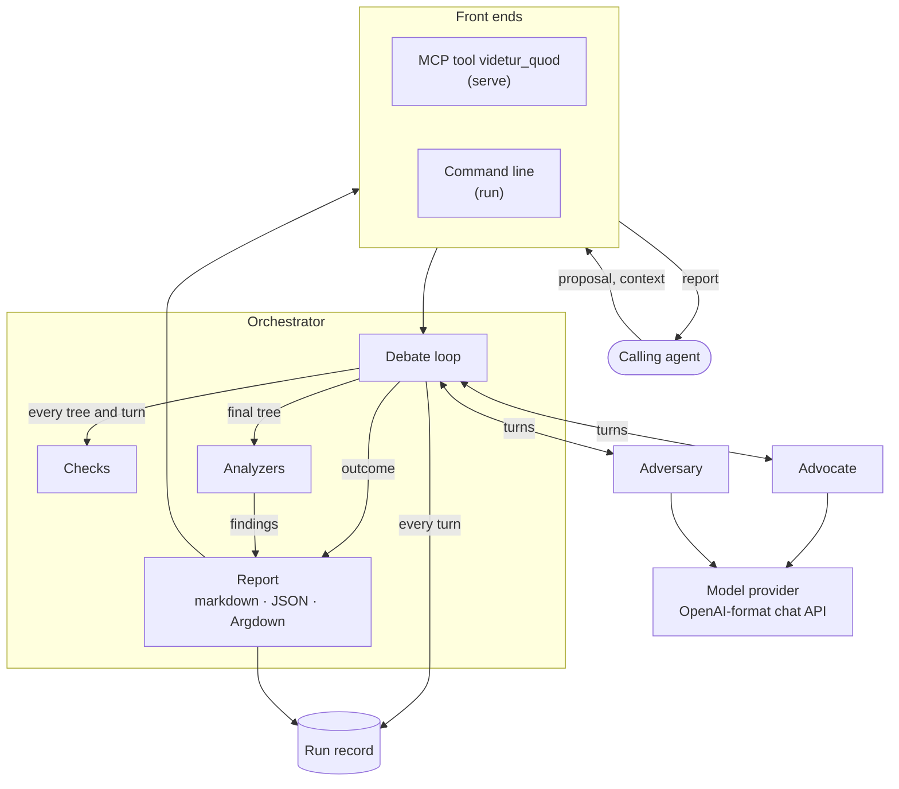

<h1 align="center"></h1>

## The principle

An agent that writes a proposal draws every link between its claims from its own model, so it has nothing else to check those links against. A link it made up therefore looks the same to it as a link that holds. A sentence that supports nothing gets past it just as easily.

Sed Contra hands that check to two other model agents. The advocate rebuilds the proposal's argument as a tree that shows which claims support which conclusion. Each claim quotes the proposal's own words, so code can check that it really comes from the proposal. The adversary then attacks the tree. Each further round lets the advocate answer every attack and fix the tree, and lets the adversary reply.

An attack counts only if it proves its point in one of three ways:

- a **gap**: a case where the reasons hold and the conclusion still fails;
- an **unneeded reason**: the conclusion follows without it;
- a **misreading**: a quote of the passage the advocate read wrong.

The advocate must meet the same bar when it rejects an attack, so both sides argue with cases and quotes the other can check. When a gap points to a missing reason that happens to be true, the advocate still adds it to the tree, because the proposal relied on it without saying so.

The report lists every attack and how it ended, what the tree had to change, what is still open, and the text the argument never uses. It gives no verdict on the proposal, because the agent that asked decides what to do with it.

## Architecture



Each part of the diagram lives in its own module:

| Part | Module | Job |
| --- | --- | --- |
| Front ends | `src/mcp.rs`, `src/main.rs` | Take the proposal and its context from the caller and return the report, as an MCP tool over stdio or as a command. |
| Orchestrator | `src/run.rs`, `src/debate.rs` | Passes each turn between the advocate and the adversary and ends the debate. |
| Advocate, adversary | `src/actor.rs`, `agents/` | Each runs as its own task with its own history and no tools, so it sees only what the orchestrator sends it. |
| Checks | `src/check/` | Reject a malformed tree or turn before the debate goes on. |
| Model provider | `src/provider/` | Sends each agent's requests to the provider its configuration names, DeepSeek by default. |
| Analyzers | `src/analyze/` | Compute the findings from the final tree without a model call. |
| Report | `src/report/` | Builds the report from the debate's outcome and the findings, and renders it as markdown, JSON and Argdown. |
| Run record | `src/record.rs` | Writes one folder per run with the inputs, the resolved settings, every turn as it completes, and the report. |
| Evaluation | `src/eval.rs` | Runs the orchestrator on each record of the Arguinas test split, then has a judge agent score each report against the record's reference reconstruction. |

A run goes through five steps:

1. **Reconstruction.** The advocate rebuilds the proposal's argument as a tree whose nodes are claims and whose edges are inferences `P, Q → Z`. Every claim carries the exact quotes that state it. The first tree repairs nothing, so every later change traces back to a critique.
2. **Checks.** Code rejects a turn when:
   - its tree has a loop, a reference to an unknown claim, or no marked conclusion;
   - it quotes text that does not occur in the proposal word for word;
   - a critique or an answer in it lacks its required parts;
   - it leaves a critique unanswered.

   A rejected turn gets one retry with the failures listed; if the retry fails too, the run fails.
3. **Debate.** The adversary critiques the tree under the rules above. The advocate accepts, adapts or rejects each critique, revising the tree for each one it accepts or adapts. The adversary then drops or maintains each rejected critique before it critiques the revised tree. The debate ends when the adversary is satisfied or the round limit is reached.
4. **Findings.** The analyzers compare the final tree with the proposal to find restatements, stretches of text no quote covers, and stubs: claims from which no inference reaches a conclusion.
5. **Report.** The report states how the debate ended and holds a ledger of every critique with its final status, the final tree in Argdown, the changes the debate forced, the critiques left open or unanswered, the findings and the full transcript.

[SPEC.md](SPEC.md) holds the full design, including the rules of the debate and every field of the report.

## Installation

Prerequisites:

- Rust 1.95 or later;
- an API key for DeepSeek or another provider with an OpenAI-format chat API.

The paths below are those on Linux.

1. Install the binary into `~/.cargo/bin`, which rustup puts on your PATH:

   ```sh
   cargo install --path .
   ```

   Run the same command after pulling changes to update the installed binary.

2. Store the provider's key in your own terminal, not through an agent, so that the key never passes through an agent's context:

   ```sh
   sedcontra key set deepseek
   ```

   The command reads the key without echoing it and stores it in `~/.config/sedcontra/keys/deepseek`, a file only you can read. The environment variable `DEEPSEEK_API_KEY` is a fallback for CI, read only when no key file exists. Do not export it in a shell profile or pass it to an MCP client with `-e`: an agent with a shell can print the first, and an agent with file tools can read the second from the client's configuration.

3. Deny agents the key directory, because an agent that runs commands as you can read any file you can. In Claude Code, add this rule to `~/.claude/settings.json`:

   ```json
   { "permissions": { "deny": ["Read(~/.config/sedcontra/keys/**)"] } }
   ```

   The rule covers Claude Code's file tools and the file commands it recognises in Bash, such as `cat`, but not a script that opens the file itself. [Claude Code's sandbox](https://code.claude.com/docs/en/sandboxing) blocks that script too, because it restricts every process.

4. Register the MCP server, here with Claude Code:

   ```sh
   claude mcp add sedcontra -- "$(command -v sedcontra)" serve
   ```

   A client whose tool calls time out before a debate ends can instead run the command line in the background. It prints the report to stdout as `md`, `json` or `argdown`:

   ```sh
   sedcontra run proposal.md --context context.md --format md
   ```

### Configuration

The defaults are in [config/default.toml](config/default.toml). A `sedcontra.toml` in the working directory, or else `~/.config/sedcontra/config.toml`, overrides any of its values, table by table.

- To run an agent on another provider, add the provider under `[providers]`, store its key as in step 2, and name the provider in that agent's `[models.<agent>]` table.
- To change a prompt without rebuilding, put a file with the same name as one in [agents/](agents/) into `.sedcontra/agents/` or `~/.config/sedcontra/agents/`.

## References

- Hyun Ryu, Gyouk Chu, Gregor Betz, Eunho Yang, Carolyn Rose and Sean Welleck. *Argument Reconstruction as Supervision for Critical Thinking in LLMs*. [arXiv:2603.17432](https://arxiv.org/abs/2603.17432), 2026. It introduces the GAAR reconstruction engine, whose reduction to minimal premise sets the superfluous-premise critique adopts, and the Arguinas dataset.
- [Arguinas](https://github.com/GyoukChu/Arguinas): the code and data whose test split the evaluation scores against. The dataset states no license, so download it for local use and keep it out of the repository.
- [Argdown](https://argdown.org): the syntax of the final tree, which opens as an argument map in Argdown's tools.
- [Adversarial agents example in Microsoft's MCP for Beginners](https://github.com/microsoft/mcp-for-beginners/blob/main/05-AdvancedTopics/mcp-adversarial-agents/README.md): the source of the per-agent histories.
- [Elenchus](https://github.com/jhlee0409/elenchus-mcp): tracks every issue in a debate through explicit states, which the critique ledger adopts.
