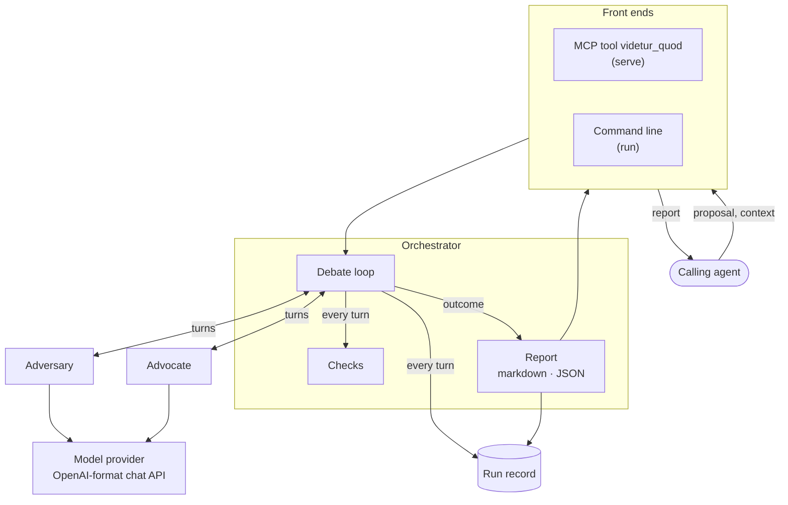

<h1 align="center"></h1>

One agent attacks the argument, the other defends it from the text.

## The idea

An agent can't really review its own proposal. Every step in the argument came out of the same model that would be doing the checking, so a step it made up looks just as solid to it as one that's true. Filler gets through the same way, because a sentence that supports nothing still reads fine.

Sed Contra gets that review from outside. The adversary reads the proposal and raises every critique it can substantiate, each aimed at the proposal's own words, and code checks that every quote really is in the text. The advocate then defends the proposal from those same words. It accepts a critique that shows a failure, and it argues back only when the critique misreads the passage or doesn't say what fails. The adversary drops a critique whose discussion is right, presses one whose discussion is not, and says when it has nothing left.

A critique has to prove its point. "This seems weak" doesn't count, and neither does "this needs a definition". It has to do one of five things:

- show a gap, with a case where the premises are true and the conclusion is still false;
- show a step that assumes what it concludes, by quoting the premise and the conclusion;
- show two sentences that can't both hold, by quoting both;
- show a word that changes meaning between a premise and a conclusion, by quoting both uses;
- show text the argument never uses, by quoting it.

Say a proposal argues "our queries are slow, so we should move to Postgres". The adversary can answer that the queries might be slow because an index is missing, and then moving to Postgres fixes nothing. That's a gap: the proposal assumed, without saying so, that the database was the problem.

The advocate plays by the same rules. It can't wave off a missing premise because the premise happens to be true: if the proposal doesn't say it, the critique stands. It can't answer a critique by quoting the sentence under attack, because the question is what that sentence rests on. And it never proposes wording of its own; only the adversary words a critique.

The report lists every critique and how it ended: accepted, with what the argument now lacks; dropped, with the reading that answered it; or still open, with both sides' arguments. It doesn't say whether the proposal is good. That's for the agent that asked.

## Architecture



A run has four steps:

1. **Critiques.** The adversary reads the proposal and raises every critique it can substantiate, each at the places it targets, quoted word for word.
2. **Checks.** Code rejects a turn when:

   - it quotes text that isn't in the proposal word for word;
   - a critique, an answer or a response in it is missing a required part;
   - it leaves a critique unanswered, or a discussed critique without a response.

   A rejected turn gets one retry with the failures listed. If the retry fails too, the run fails.
3. **Debate.** The advocate accepts or discusses each critique. The adversary drops each discussed critique or presses it with what the advocate asked for, then raises what the answers open up. This goes on until the adversary is satisfied or the round limit is reached.
4. **Report.** The report says how the debate ended. It holds a ledger of every critique with its status, the accepted, dropped and open critiques with both sides' words, and the full transcript.

The full design, including the discipline and every field of the report, is in [SPEC.md](SPEC.md).

## Installation

You need:

- Rust 1.95 or later;
- an API key for DeepSeek or another provider with an OpenAI-format chat API.

Paths below are for Linux.

1. Install the binary into `~/.cargo/bin`, which rustup puts on your PATH:

   ```sh
   cargo install --path .
   ```

   Run it again after you pull to update the installed binary.
2. Store the provider's key yourself, in your own terminal.

   ```sh
   sedcontra key set deepseek
   ```

   The command reads the key without echoing it and stores it in `~/.config/sedcontra/keys/deepseek`, a file only you can read.
3. Register the MCP server. With Claude Code:

   ```sh
   claude mcp add sedcontra -- "$(command -v sedcontra)" serve
   ```

   A debate can take several minutes. If your client's tool calls time out before it finishes, run the command line in the background instead. It prints the report to stdout as `md` or `json`:

   ```sh
   sedcontra run proposal.md --context context.md --format md
   ```

### Configuration

Defaults live in [config/default.toml](config/default.toml). Sed Contra reads `sedcontra.toml` from the working directory if there is one, otherwise `~/.config/sedcontra/config.toml`, and lays it over the defaults table by table.

- To run an agent on another provider, add the provider under `[providers]`, store its key as in step 2, and name the provider in that agent's `[models.<agent>]` table.
- To change a prompt without rebuilding, copy its file from [agents/](agents/) into `.sedcontra/agents/` or `~/.config/sedcontra/agents/` and edit the copy, or pass a file for one run with `--adversary` or `--advocate`.

## References

- Hyun Ryu, Gyouk Chu, Gregor Betz, Eunho Yang, Carolyn Rose and Sean Welleck. *Argument Reconstruction as Supervision for Critical Thinking in LLMs*. [arXiv:2603.17432](https://arxiv.org/abs/2603.17432), 2026. The paper behind the GAAR reconstruction engine and the Arguinas dataset. The gap critique's missing premise and the unused-text critique draw on its implicit premises and minimal premise sets.
- [Arguinas](https://github.com/GyoukChu/Arguinas): code and data. An evaluation against its test split is a later option. The dataset has no license, so download it for local use and keep it out of this repository.
- [Adversarial agents example in Microsoft&#39;s MCP for Beginners](https://github.com/microsoft/mcp-for-beginners/blob/main/05-AdvancedTopics/mcp-adversarial-agents/README.md): where the idea of giving each agent its own history comes from.
- [Elenchus](https://github.com/jhlee0409/elenchus-mcp): tracks each issue in a debate through explicit states, and the critique ledger borrows that approach.
